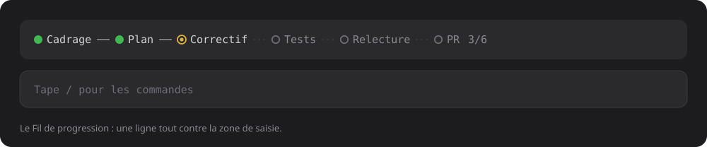
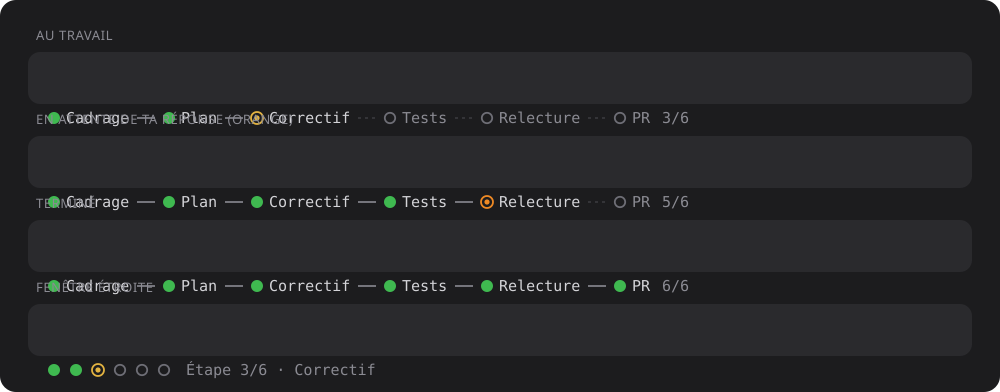

# fil-progression

Une jauge d'étapes dans le bandeau de Claude Code, au-dessus de la zone de saisie : **un rond par étape**, vert quand c'est fait, jaune pour l'étape en cours, gris pour la suite.



Pendant que Claude travaille sur une tâche en plusieurs étapes, tu vois d'un coup d'œil où il en est, sans lire le chat. Quand il te pose une question, l'étape en cours passe en orange le temps que tu répondes.

## Ce que ça affiche




| Rond | Sens |
|---|---|
| `●` vert | étape faite |
| `◉` jaune | étape en cours |
| `◉` orange | l'étape en cours attend ta réponse (une question est posée) |
| `○` gris | étape à venir |

- Un trait plein `━` relie les étapes faites, des pointillés `┄` relient celles qui restent.
- Le compteur `3/6` suit les noms. Pas de pourcentage : on ne sait pas combien de temps dure une étape.
- Les noms d'étape sont raccourcis à un ou deux mots (14 caractères au plus) pour tenir sur une rangée.
- **Fenêtre étroite** : si les noms ne tiennent plus, la jauge garde les ronds seuls et nomme l'étape en cours : `● ● ◉ ○ ○ ○  Étape 3/6 · Correctif`.
- **Terminé** : à la fin du tour, tous les ronds passent au vert. La jauge s'efface à ton message suivant.
- Le bandeau cohabite avec d'autres mods : la jauge s'empile sous eux, avec une ligne vide d'écart, et se tait quand une enquête s'affiche.

## Comment elle sait où en est Claude

Le mod ne demande rien à Claude et n'écrit rien dans le chat. Il lit la liste d'étapes que Claude tient déjà :

- l'outil `update_plan` de l'app Claude Code (liste entière, « étape suivante », « étapes finies », « commence à ») ;
- l'outil `TodoWrite` du terminal ;
- le bilan de fin de tour (`wrap_up`), qui coche toute la liste ;
- l'outil `AskUserQuestion`, pour l'orange.

Pas de liste d'étapes, pas de jauge.

## Installation

Dans Claude Code :

```
/plugin marketplace add tiber76/fil-progression
/plugin install fil-progression@fil-progression
```

Ou depuis un dossier local :

```
/plugin marketplace add /chemin/vers/fil-progression
/plugin install fil-progression@fil-progression
```

Puis **redémarre la session**.

## Commande

`/fil` masque ou réaffiche la jauge. Le choix est gardé d'une session à l'autre.

## Limites connues

- Le rouge « bloqué » n'est pas déduit : seul l'orange l'est.
- Le bandeau (`AbovePrompt`) n'existe que sur le terminal et l'app desktop, pas sur VS Code ni mobile.
- La lecture de `TodoWrite` (terminal) réutilise la logique d'`update_plan`, mais je ne l'ai pas vue tourner en vrai : seul le chemin `update_plan` de l'app desktop a été regardé à l'écran.
- La place de la jauge parmi d'autres mods dépend de l'ordre de chargement des mods.

## Développement

```
claude plugin validate .   # lit le manifeste et le code comme le moteur
claude plugin test .       # joue register.test.tsx
```

La logique (noms, lecture des appels d'étapes) est dans `hooks/register.tsx`, ses tests dans `hooks/register.test.tsx`, le contrat de l'état dans `types/index.d.ts`.

## Licence

MIT, voir [LICENSE](LICENSE).
